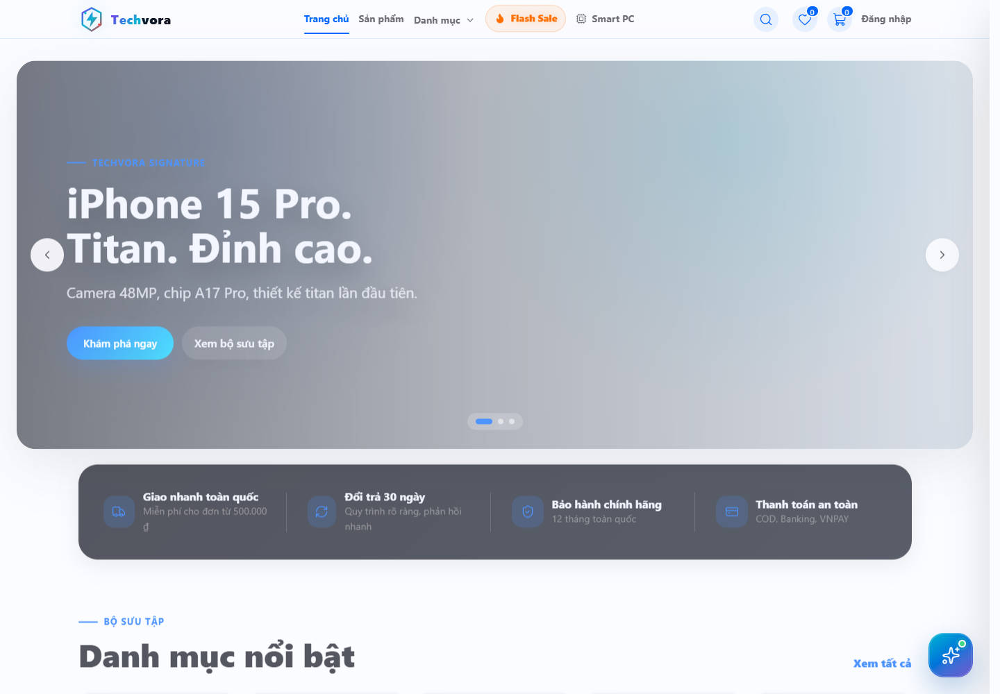
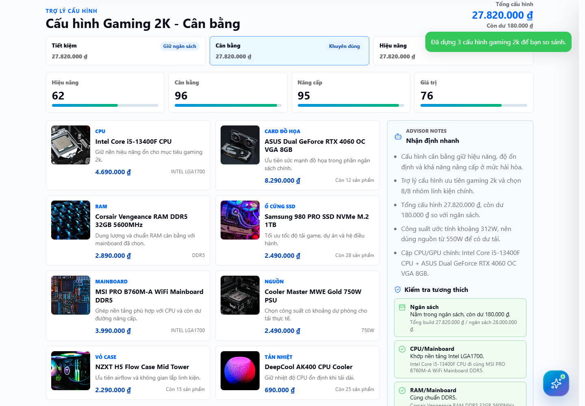
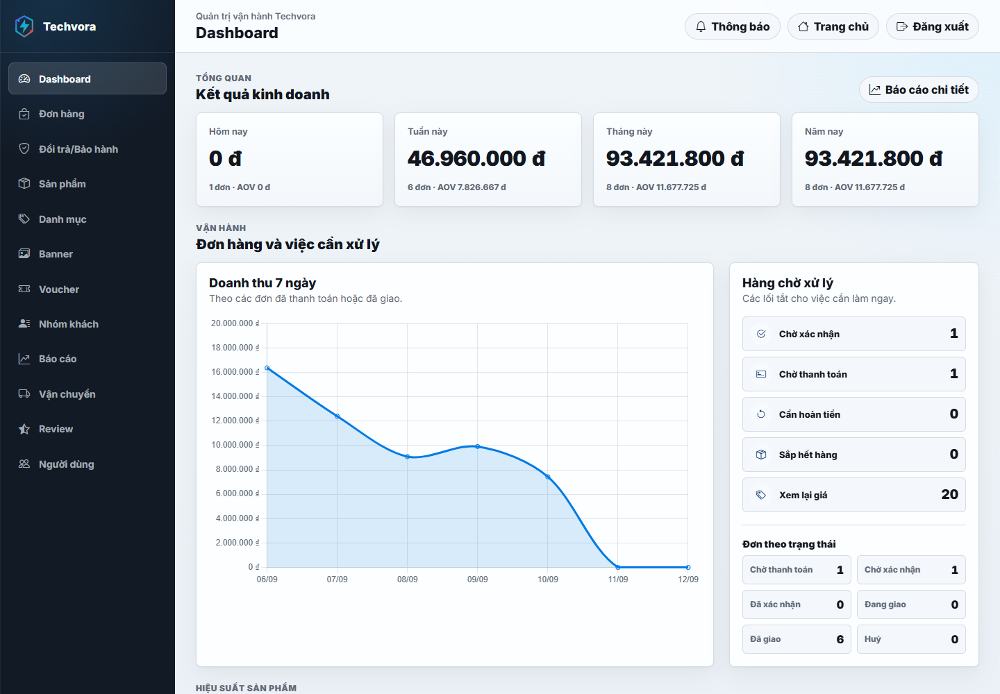

# Techvora — ASP.NET Core E-Commerce

Website bán thiết bị công nghệ được xây dựng bằng **ASP.NET Core 8 MVC, EF Core, SQL Server và ASP.NET Core Identity**. Giao diện tiếng Việt, hỗ trợ desktop và mobile.



## Chức năng nổi bật

| Luồng | Chức năng |
| --- | --- |
| Mua sắm | Tìm kiếm, lọc/sắp xếp, phân trang, wishlist, so sánh và giỏ hàng |
| Đặt hàng | Voucher, COD, VNPAY sandbox, hủy đơn và mua lại |
| Vận chuyển | Tích hợp GHN, theo dõi đơn, đổi trả và bảo hành |
| Quản trị | Sản phẩm, danh mục, tồn kho, đơn hàng, báo cáo và người dùng |
| Smart PC Builder | Đề xuất cấu hình theo ngân sách và kiểm tra tương thích linh kiện |
| Gợi ý sản phẩm | Gợi ý theo hành vi và chatbot Gemini khi có cấu hình API |





## Công nghệ

- ASP.NET Core 8 MVC, Razor Views và SignalR
- Entity Framework Core 8, SQL Server và ASP.NET Core Identity
- HTML, CSS và JavaScript; asset dùng để chạy đã có sẵn trong `wwwroot`
- Tích hợp tùy chọn: VNPAY, GHN, SMTP và Gemini

## Chạy dự án

Yêu cầu: **.NET SDK 8+** và **SQL Server** có quyền tạo database. Không cần cài Node.js hoặc Docker để chạy ứng dụng.

```powershell
git clone https://github.com/Anhtuan2005/E-Lectrical--Commerce-.git
cd E-Lectrical--Commerce-
dotnet restore EcommerceApp.sln
dotnet tool restore

# Có thể thay localhost bằng SQL Server instance trên máy của bạn.
dotnet user-secrets set "ConnectionStrings:DefaultConnection" "Server=localhost;Database=TechvoraDemo;Trusted_Connection=True;TrustServerCertificate=True;Encrypt=False"
dotnet tool run dotnet-ef database update

# Bật dữ liệu minh họa trên database demo riêng.
$env:Demo__Enabled = "true"
$env:Email__Enabled = "false"
dotnet run --project EcommerceApp.csproj --launch-profile http
```

Mở [http://localhost:5009](http://localhost:5009).

| Tài khoản demo | Mật khẩu | Quyền |
| --- | --- | --- |
| `admin@shop.vn` | `Admin@123` | Admin |
| `khachhang1@shop.vn` | `User@123` | Khách hàng |

`Demo:Enabled` mặc định là `false` và không được phép bật trong môi trường Production. Khi dùng xong, xóa biến demo bằng `Remove-Item Env:Demo__Enabled`.

## Cấu trúc chính

```text
Controllers/     Điều hướng request, phân quyền và trả View/JSON
Data/            DbContext, migrations và dữ liệu demo
Hubs/            Cập nhật thời gian thực bằng SignalR
Models/          Entity và ViewModel
Services/        Nghiệp vụ và tích hợp dịch vụ ngoài
Views/           Giao diện Razor cho storefront và trang quản trị
wwwroot/         CSS, JavaScript, hình ảnh và mô hình 3D
```

## Cấu hình tùy chọn

Dùng `dotnet user-secrets` khi phát triển và biến môi trường khi triển khai; trong tên biến môi trường, thay `:` bằng `__`.

| Cấu hình | Mục đích |
| --- | --- |
| `ConnectionStrings:DefaultConnection` | Kết nối SQL Server |
| `Demo:Enabled` | Tạo dữ liệu demo; mặc định `false` |
| `BootstrapAdmin:Email`, `BootstrapAdmin:Password` | Tạo tài khoản quản trị ban đầu |
| `Vnpay:*` | Thanh toán VNPAY sandbox |
| `Email:*` | Gửi email đặt lại mật khẩu |
| `Ghn:*` | Tạo và theo dõi vận đơn GHN |
| `Gemini:ApiKey`, `Gemini:Model` | Chatbot hỗ trợ khách hàng |

Các tích hợp ngoài được tắt hoặc hoạt động ở chế độ dự phòng khi chưa cung cấp thông tin xác thực, nên không bắt buộc để chạy bản demo cục bộ.
